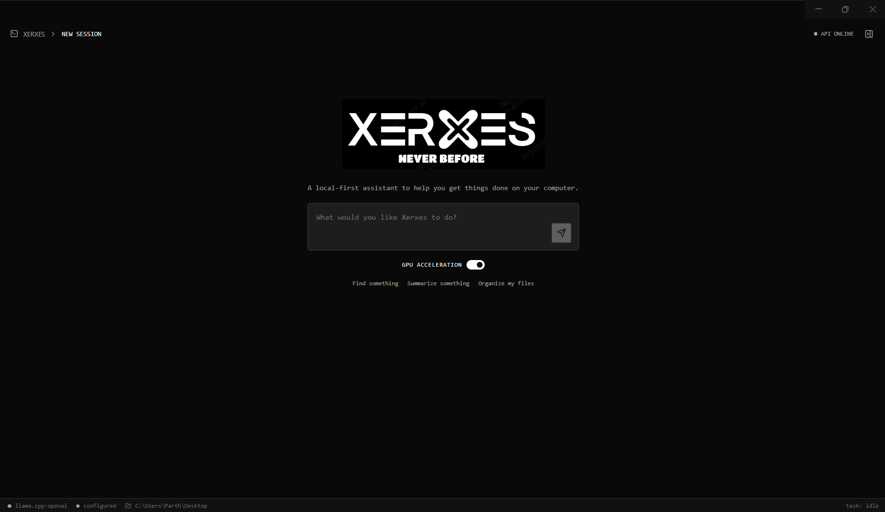
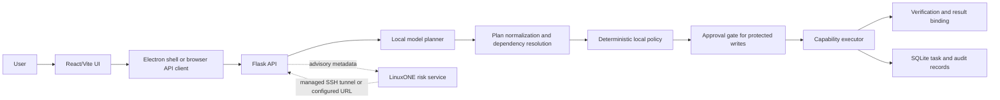

# Xerxes

Xerxes is a local-first Windows desktop agent for planning and carrying out workspace tasks. It combines a React/Vite interface, an Electron desktop shell, a Flask API, a structured local-model planner, deterministic filesystem policy, approval-gated writes, and an auditable executor.

This README describes the repository as it exists today. Features marked **live-verified** were exercised in a development environment; that does not imply that every packaged GUI path or every deployment target has been manually tested.



## Contents

- [Status at a glance](#status-at-a-glance)
- [What Xerxes does](#what-xerxes-does)
- [Architecture](#architecture)
- [Technology and repository map](#technology-and-repository-map)
- [Requirements](#requirements)
- [Run Xerxes locally](#run-xerxes-locally)
- [Configuration](#configuration)
- [Local model runtime](#local-model-runtime)
- [GPU acceleration](#gpu-acceleration)
- [Workspaces, files, and PDFs](#workspaces-files-and-pdfs)
- [LinuxONE risk service](#linuxone-risk-service)
- [Verification service roadmap](#verification-service-roadmap)
- [Security and privacy](#security-and-privacy)
- [Auditability and failure behavior](#auditability-and-failure-behavior)
- [Testing and validation](#testing-and-validation)
- [Troubleshooting](#troubleshooting)
- [Roadmap](#roadmap)
- [Contributing](#contributing)
- [Acknowledgements](#acknowledgements)

## Status at a glance

| Area | Status | Notes |
| --- | --- | --- |
| React/Vite interface | Implemented and tested | Browser development UI and workspace/task views are present. |
| Electron desktop app | Implemented and tested at source/build level | Electron owns the backend in desktop mode; packaged GUI behavior still needs manual verification on each target machine. |
| Structured planning and action normalization | Implemented and tested | Planner output is normalized and checked before execution. |
| Filesystem policy, grants, approvals, and audit | Implemented and tested | The local policy remains authoritative over model suggestions and risk scores. |
| File search, read, text creation, and PDF workflows | Implemented and tested | Tests use isolated temporary workspaces. |
| CPU local-model runtime | Implemented | The HTTP-compatible llama.cpp path and fallback configuration are supported. |
| CUDA local-model runtime | Experimental and live-verified | Real development-machine CUDA offload was observed; runtime/model compatibility remains machine-dependent. |
| LinuxONE risk integration | Experimental and live-verified | Uses an advisory synthetic model through a managed SSH tunnel or direct URL. |
| Remote verification worker | In progress | A local static-analysis prototype exists; a safe remote deployment is not yet claimed. |
| Malware scanning and broad sandboxing | Planned | Not represented as an available capability today. |

## What Xerxes does

- Accepts natural-language workspace requests through the local UI.
- Asks a configured local model for a structured action plan.
- Validates tool names, arguments, dependencies, references, and grounding.
- Resolves paths against the active workspace and explicitly authorized grants.
- Searches and reads files, creates text files, and generates PDFs through registered capabilities.
- Stops for approval before protected writes and records decisions in the audit log.
- Shows task progress, results, errors, workspace state, model state, and runtime telemetry.
- Optionally sends structured, non-content action metadata to the LinuxONE risk service. That service is advisory; it never grants filesystem permission.

## Architecture



The model proposes actions; it does not authorize them. Path containment, grant checks, approval requirements, execution, and audit logging are enforced locally.

## Technology and repository map

| Path | Purpose |
| --- | --- |
| `src/` | React renderer, UI components, styling, and Vite entry point. |
| `electron/` | Desktop main process, preload bridge, development supervisor, and lifecycle checks. |
| `backend/` | Flask API, agent engine, capability registry, policy, persistence, model adapters, and tests. |
| `native/` | Optional native-provider integration and its build/smoke-test files. |
| `risk_service/` | LinuxONE-compatible advisory risk service and tests. |
| `verification_service/` | Local AST/ZIP verification prototype; not a deployed remote worker. |
| `deploy/` | Example systemd unit for the risk service. |
| `scripts/` | Packaging/update helper scripts. |
| `Keys/` | Local development key material area. Private keys are ignored and must never be committed. |

## Requirements

For ordinary Windows development:

- Node.js and npm compatible with the installed Vite/Electron toolchain.
- Python 3 with a virtual environment.
- The packages in `backend/requirements.txt`.
- A local model runtime, such as a compatible llama.cpp server, when planning is needed.

The packaged application includes the frontend and backend resources, but still requires a compatible Python installation unless a future distribution bundles one. Native CUDA execution additionally requires a compatible NVIDIA driver/runtime and model binary.

## Run Xerxes locally

From the repository root, create or activate a project-local environment and install the backend requirements:

```powershell
py -m venv .venv
.\.venv\Scripts\python.exe -m pip install -r backend\requirements.txt
npm install
```

Start the Flask API in one terminal:

```powershell
$env:XERXES_WORKSPACE = (Get-Location).Path
$env:XERXES_DATABASE = "$((Get-Location).Path)\backend\xerxes.db"
.\.venv\Scripts\python.exe backend\app.py
```

For browser development, start Vite in another terminal and open the displayed URL:

```powershell
npm run dev
```

For the Electron development shell, use the supervisor, which starts and owns the backend:

```powershell
npm run desktop:dev
```

Build or package the desktop application with:

```powershell
npm run build
npm run desktop:build
npm run desktop:dist
```

Do not run both a manually started backend and the Electron-owned backend on the same port unless you intentionally configure separate ports.

## Configuration

Only set variables needed for the environment. Empty or absent workspace configuration is represented in the UI as **No workspace selected**; the backend retains an internal safe root for implementation but does not expose it as the active workspace.

| Variable | Purpose |
| --- | --- |
| `XERXES_WORKSPACE` | Active workspace selected for the backend process. |
| `XERXES_DATABASE` | SQLite database path. |
| `PORT` | Flask API port; defaults to `5000`. |
| `XERXES_CORS_ORIGINS` | Comma-separated allowed development origins. |
| `XERXES_LOCAL_MODEL_URL` | Existing OpenAI-compatible local model endpoint. |
| `XERXES_LOCAL_MODEL` | Model name sent to the local runtime; the code default is `qwen2.5-coder:1.5b`. |
| `XERXES_MODEL_PROVIDER` | Set to `native` to select the optional native provider; otherwise the HTTP path is used. |
| `XERXES_LLAMA_SERVER_EXE` | llama.cpp server executable. |
| `XERXES_LOCAL_MODEL_PATH` | GGUF model path for managed/native runtime use. |
| `XERXES_LLAMA_SERVER_PORT` | Managed llama.cpp server port; defaults to `56322`. |
| `XERXES_RUNTIME_SETTINGS` | Runtime settings JSON path. |
| `XERXES_GPU_MODE` | `cpu` or `cuda`. |
| `XERXES_GPU_LAYERS` | Requested llama.cpp GPU layer count; defaults to `16` for the verified RTX 3050 profile. |
| `XERXES_OLLAMA_URL` | Ollama-compatible endpoint; defaults to `http://127.0.0.1:11434`. |
| `XERXES_NATIVE_DLL` / `XERXES_NATIVE_RUNTIME_DIR` / `XERXES_NATIVE_THREADS` | Optional native-provider settings. |
| `XERXES_RISK_URL` | Direct risk-service URL. |
| `XERXES_LINUXONE_SSH_HOST` / `XERXES_LINUXONE_SSH_USER` / `XERXES_LINUXONE_SSH_KEY` | Managed SSH-tunnel connection settings. |
| `XERXES_LINUXONE_REMOTE_PORT` / `XERXES_LINUXONE_LOCAL_PORT` | Remote and local tunnel ports; both default to `5001`. |

LinuxONE connection settings may also be stored outside the repository in
`%LOCALAPPDATA%\Xerxes\linuxone.json` (or the directory named by
`XERXES_CONFIG_DIR`). Process environment variables take precedence over this
file. The file contains connection metadata only; keep the private key in its
separate external path. The backend reports the selected source and missing
field names without returning configuration values.
| `XERXES_GRANT_TOKEN` | Token used by protected folder-grant endpoints. |
| `XERXES_VERIFICATION_TOKEN` | Token for the local verification prototype. |
| `VITE_API_BASE_URL` | Browser renderer API base override when not using the Electron bridge. |

## Local model runtime

The planner accepts structured model output and converts it to the canonical capability contract. A managed llama.cpp server can be started by Electron when `XERXES_LLAMA_SERVER_EXE` and `XERXES_LOCAL_MODEL_PATH` resolve to existing files. An already-running compatible endpoint can instead be supplied with `XERXES_LOCAL_MODEL_URL`.

Planner failure is not treated as permission to guess. Xerxes records an actionable diagnostic or uses only a narrowly supported deterministic fallback. A valid plan still passes normalization, grounding, argument validation, policy, approval, and executor checks.

## GPU acceleration

The runtime exposes requested mode, effective mode, configured layers, observed offload evidence, process ID, and the last inference in the health/runtime response. On the development machine, CUDA offload was live-verified with the managed llama.cpp runtime and a Qwen2.5 GGUF model. This evidence is machine- and model-dependent; `XERXES_GPU_LAYERS=16` is a default request, not a guarantee that every model will offload exactly that many layers.

CPU fallback remains supported. A runtime can report CUDA requested but CPU effective if the executable, driver, model, or launch configuration cannot provide verified offload. Per-process NVIDIA utilization may be unavailable even when llama.cpp log evidence confirms offload. On the verified RTX 3050 4 GB profile, 16 layers is the default tested balance; set `XERXES_GPU_LAYERS=12` to retain the lower-memory setting or use another explicit value only after testing it on the target machine.

## Workspaces, files, and PDFs

The active workspace is separate from filesystem grants. A workspace is the user-selected working root. Grants are explicit authorized roots, such as an authorized Desktop directory. The internal safe root used when no workspace is selected is not displayed as the user's workspace.

Implemented workflows include:

1. Search with bounded query and directory handling.
2. Read a selected file after a real search result is resolved.
3. Create a text file through the registered write capability, subject to authorization and approval.
4. Generate a PDF from supplied content.
5. Generate a PDF from content read from an earlier action.

Tests use temporary roots and verify actual file/PDF artifacts rather than relying only on task status. Unauthorized destinations remain blocked; Xerxes does not silently substitute another user directory.

## LinuxONE risk service

The optional risk service is a Flask service exposing health, model information, and risk scoring endpoints. Its current model is a deterministic synthetic logistic-regression prototype trained on 32 generated samples. It returns a risk score, category, model version, and advisory fields.

Development configuration can use a direct URL or a local managed SSH tunnel. Use placeholders in local documentation and supply real values only through environment variables:

```powershell
$env:XERXES_LINUXONE_SSH_HOST = "<LINUXONE_HOST>"
$env:XERXES_LINUXONE_SSH_USER = "<SSH_USER>"
$env:XERXES_LINUXONE_SSH_KEY = "C:\path\to\private-key.pem"
$env:XERXES_LINUXONE_REMOTE_PORT = "5001"
$env:XERXES_LINUXONE_LOCAL_PORT = "5001"
```

The tunnel uses normal OpenSSH host-key verification and does not disable host-key checking. Use a key with restrictive local permissions. Never put a private key, real host, username, or token in source control or documentation.

The client sends only structured action metadata: `action_category`, `inside_workspace`, `reversible`, `network`, `approval`, `data_sensitivity`, and `privilege`. It does not send file contents. The local policy remains authoritative if the service is unavailable, returns an invalid response, or recommends a permissive outcome.

The repository contains a systemd unit under `deploy/` for a separately configured LinuxONE service. Deployment, hardening, service credentials, and host-specific values must be performed by the operator; this README does not claim a production deployment.

## Verification service roadmap

`verification_service/` contains a local prototype for static Python syntax and archive checks. It parses Python with the AST without executing submitted code and exposes a small authenticated API. It is useful for deterministic local tests, but it is **not** currently integrated as a remote Xerxes worker and has not been claimed as a safe multi-tenant sandbox.

A future remote verifier needs an isolated runtime, resource limits, authenticated transport, artifact limits, explicit network policy, durable job state, and independent deployment evidence. Until those controls exist, do not describe the prototype as remote code execution or as a complete malware scanner.

## Security and privacy

- The model is untrusted input to the policy layer, not a security boundary.
- Canonical capability names and schemas are validated before dispatch.
- Paths are resolved and checked against the active workspace or explicit grants.
- Writes and other protected operations retain existing approval requirements.
- Audit records include action, authorization decision, result, and advisory risk metadata where available.
- The risk service receives structured metadata, not workspace file contents.
- Network transfer is not silently enabled by model output.
- Private keys belong outside Git-tracked content; ignored does not mean safe to disclose.
- The Electron preload boundary exposes only the intended API bridge.

No license file was identified in the repository. Add an explicit license before redistributing the project.

## Auditability and failure behavior

Tasks and their plans/results are persisted in SQLite. The API exposes task state, audit entries, health, capabilities, and workspace state. A failed planner, unavailable remote service, invalid dependency, policy denial, approval pause, or execution exception is represented as a task/error state rather than being silently reported as completed.

Risk scoring is advisory telemetry. It must not be interpreted as malware detection, authorization, or proof that an action is safe. The deterministic local policy and approval flow are the controls that decide whether an action may run.

## Testing and validation

Use the project-local interpreter for backend checks:

```powershell
npm run build
.\.venv\Scripts\python.exe -m pytest -q backend/tests
.\.venv\Scripts\python.exe -m pytest -q verification_service/test_app.py
.\.venv\Scripts\python.exe -m compileall -q backend verification_service risk_service
node --check electron/main.cjs
node --check electron/preload.cjs
node electron/supervisor-lifecycle.test.cjs
git diff --check
```

The risk service tests require the scientific dependencies declared in `risk_service/requirements.txt`; run them in an environment where the pinned scikit-learn stack is installed:

```powershell
.\.venv\Scripts\python.exe -m pytest -q risk_service/test_risk.py
```

Do not treat a successful frontend build as proof that the packaged GUI was launched. Perform a manual `npm run desktop:dist` install/launch check when validating a release artifact.

## Troubleshooting

| Symptom | Checks |
| --- | --- |
| `Desktop API unavailable` | Use `npm run desktop:dev`, or start the Flask API and set `VITE_API_BASE_URL`. |
| `No workspace selected` | Select a folder through the existing folder-access flow or set `XERXES_WORKSPACE` before starting the backend. |
| Model is unavailable | Check the model endpoint, managed server executable, GGUF path, port, and the model/runtime health response. |
| CUDA requested but not effective | Inspect runtime telemetry and llama.cpp logs; verify the driver, executable, model, and requested layer count. |
| LinuxONE risk is unavailable | Check SSH host/user/key variables, normal host-key verification, tunnel port availability, and remote health/model-version responses. Local policy continues to apply. |
| A write pauses | Review the task's approval requirement and audit entry; do not bypass approval by editing the database. |
| A verification request is rejected | Remember that the current verification service is a local static-analysis prototype, not an unrestricted execution worker. |

## Roadmap

- Finish a safely isolated remote verification worker and integrate it behind explicit capability/policy controls.
- Add malware scanning and richer artifact inspection without weakening local authorization.
- Improve packaged-runtime onboarding and machine-specific GPU diagnostics.
- Add a formal project license and release documentation.
- Expand test coverage for packaged Electron flows and supported deployment targets.

## Contributing

Keep changes focused and evidence-driven. Add deterministic tests for behavior changes, use temporary workspaces for filesystem tests, keep secrets and model weights outside the repository, and report environment limitations precisely. Before opening a change, run the relevant backend tests, frontend build, Electron checks, compilation checks, and `git diff --check`.

## Acknowledgements

Xerxes uses React, Vite, Electron, Flask, pytest, ReportLab, scikit-learn, and llama.cpp-compatible local model runtimes. Their respective licenses and notices remain authoritative.
